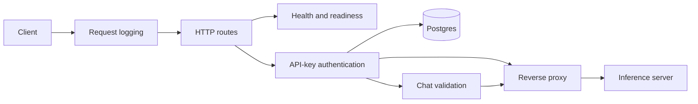

# llmgate

`llmgate` is an OpenAI-compatible LLM gateway written in Go. It accepts HTTP
requests and forwards them to one inference server, such as llama.cpp. The
backend loads the model and generates tokens; the gateway handles HTTP routing,
API-key authentication, request validation, cancellation, and deadlines.

Phase 1 is in progress. Health checks, model listing, JSON and streaming chat,
and request IDs with structured logs work today. Models and chat require an
active API key stored as a hash in Postgres. A local command provisions keys;
the development Compose setup runs Postgres and migrations. An opt-in loopback
admin listener can create and revoke keys over HTTP. Revocation cancels that
key's active requests in this process. A bounded authentication cache keeps
unexpired identities available during database outages. Rate limits, usage
tracking, metrics, and the full Compose stack are still planned. A
[GLM single-stream baseline](docs/benchmarks.md) records 100 sequential requests
split between direct and gateway paths. GLM-Edge-4B-Chat Q6_K is the primary
model; the earlier Qwen baseline remains historical evidence.

Normal local inference uses CUDA on the RTX 3060. A
[CPU/GPU comparison](docs/benchmarks.md#local-cpu-and-gpu-check-on-october-16-2026)
verified full model offload and measured median decode rates of 13.82 and
51.27 tokens/s respectively. The Go gateway runs on the CPU.

## Run locally

Use Go 1.27 or later. Follow the [GLM setup and testing guide](docs/manual-testing.md)
to start the CUDA backend with the downloaded GLM-Edge-4B-Chat Q6_K file and the alias
`glm-edge-4b-chat`. First follow [Postgres setup](docs/manual-testing.md#postgres-key-storage)
and [key creation](docs/manual-testing.md#api-key-authentication). Export
`GATEWAY_DATABASE_URL` and `PGPASSWORD` in the gateway terminal and `API_KEY`
in the client terminal. Set the backend's base URL without the `/v1` suffix:

```sh
GATEWAY_UPSTREAM_URL=http://127.0.0.1:8081 go run ./cmd/gateway
```

The gateway listens on port 8080 by default. In another terminal:

```sh
curl http://localhost:8080/v1/healthz
curl http://localhost:8080/v1/readyz
curl http://localhost:8080/v1/models -H "Authorization: Bearer $API_KEY"

# The documented backend starts with the alias glm-edge-4b-chat.
curl http://localhost:8080/v1/chat/completions \
  -H "Authorization: Bearer $API_KEY" \
  -H 'Content-Type: application/json' \
  -d '{"model":"glm-edge-4b-chat","messages":[{"role":"user","content":"Hello"}],"stream":false}'

# Stream tokens as the backend generates them.
curl -N http://localhost:8080/v1/chat/completions \
  -H "Authorization: Bearer $API_KEY" \
  -H 'Content-Type: application/json' \
  -d '{"model":"glm-edge-4b-chat","messages":[{"role":"user","content":"Hello"}],"stream":true}'
```

Without `GATEWAY_UPSTREAM_URL`, the process still starts. Health returns `200`,
while readiness and authenticated model and chat requests return `503`.
`/v1/healthz` checks only the gateway process. `/v1/readyz` sends a fresh `GET /health` to the backend
and returns `200` only when that endpoint returns `200`. Backend base paths
are preserved, so a base URL ending in `/api` probes `/api/health`.

Readiness has its own timeout, default `2s`. Loading responses, connection
failures, timeouts, and redirects return a fixed JSON `503`; backend response
bodies and headers stay private. A client disconnect cancels the probe. The
probe closes the backend body after receiving headers and does not wait for
its contents.

This uses llama.cpp's documented [health endpoint](https://github.com/ggml-org/llama.cpp/blob/master/tools/server/README.md#api-endpoints).
Other backends must expose the same endpoint to pass this check. Readiness
reports backend health at probe time; it does not reserve an inference slot or
gate chat traffic. Periodic health tracking and backend routing belong to Phase 2.

Database configuration is required even without an upstream backend. Startup
checks Postgres connectivity with a deadline and fails with safe diagnostics
if it cannot connect. Migrations run separately. After startup, database failures
return `503` on authentication cache misses. Unexpired cached identities and
public health checks remain available.

## How a request works



1. Request logging assigns a fresh request ID. Go's `http.ServeMux` matches
   the method and versioned path. Health and readiness remain public.
2. Models and chat pass through authentication. Exactly one
   `Authorization: Bearer <key>` header is required. The authenticator hashes the
   secret and checks a bounded in-memory identity cache. Misses query Postgres under
   a separate lookup deadline. Hits retain their original expiry.
3. Missing, malformed, unknown, and revoked keys return JSON `401`. Database
   failures and lookup deadlines on cache misses return JSON `503`. Unexpired
   cached identities remain usable during database outages. Rejections never
   reach the backend.
   Authentication adds the key identity and limits to the request context,
   preserving logging and cancellation. It registers a cancellation function until
   the handler exits. Limits are not enforced yet.
4. For chat, the handler reads the body into a bounded buffer. It requires
   `application/json`, a JSON object, and a boolean `stream` field when present.
   Explicit `max_tokens` values must be positive integers within the limit.
5. The handler preserves backend-specific fields and inserts `max_tokens` when
   omitted. `stream: true` selects SSE; other accepted requests select JSON.
   The backend validates the model, messages, and other generation options.
6. The reverse proxy removes the gateway Authorization header, sends the request
   upstream, and copies the backend's status, response headers, and body back.
   Authenticated model-list requests use the non-streaming proxy directly.

The lookup deadline ends before forwarding starts. Admin revocation persists the
change, invalidates cached identities, then cancels this process's requests for
that key. Cache admission, invalidation, and registration share a mutex. A
generation check prevents overlapping database lookups from restoring revoked
identities. Direct SQL revocation becomes visible after cache expiry and does
not signal active requests.

The cache holds at most 1,024 successful identities by default and evicts the
oldest inserted entry when full. Entries expire 30 seconds after their database
lookup started; hits never renew them. Expired entries are removed on access,
and the capacity bounds entries retained while idle. There is no background
worker or stale-entry fallback. Cache expiry affects new requests only; admitted
streams keep running. Startup still requires a reachable database.
All active keys currently have the same model and chat permissions. Use HTTPS
when exposing the gateway beyond local development.

The proxy derives its deadline from the incoming request's Go `context`, which
carries cancellation signals. A client disconnect cancels upstream HTTP work.
For JSON responses, the upstream timeout covers waiting for headers and reading
the response body. Streams have separate connect, header, and idle-read timeouts
and no total deadline. Each copied stream chunk flushes immediately. Before
headers arrive, a timeout returns `504` and a connection failure
returns `502`. After a response starts, a failure ends the incomplete response;
the gateway cannot replace a status it has already sent. Backend HTTP errors
pass through unchanged.

Every request gets a generated `X-Request-ID` response header. The gateway sends
the same ID to the backend and attaches it to request and proxy-failure logs.
Logs go to stderr as JSON and omit prompts, API keys, and raw URLs. The finish
log includes elapsed milliseconds and `completed`, which means the handler
returned normally, even for an HTTP error. An aborted stream can log
`completed: false`; its HTTP status may already have been sent.

On `SIGINT` or `SIGTERM`, the gateway stops accepting connections and gives
active requests time to finish. When admin HTTP is enabled, both listeners stop
accepting requests and drain concurrently under one shutdown deadline. Remaining
connections close when it expires. Startup binds both ports before serving; a
bind failure closes the other listener, and a later server failure stops its peer.

## Configuration

| Environment variable | Default | Controls |
| --- | --- | --- |
| `GATEWAY_DATABASE_URL` | Required | PostgreSQL connection configuration |
| `GATEWAY_DATABASE_MAX_CONNS` | `10` | Maximum shared database connections |
| `GATEWAY_DATABASE_CONNECT_TIMEOUT` | `5s` | Pool startup and individual connection deadlines |
| `GATEWAY_AUTH_LOOKUP_TIMEOUT` | `2s` | Authentication lookup and local key insertion deadline |
| `GATEWAY_AUTH_CACHE_TTL` | `30s` | Fixed successful-identity lifetime, must be positive |
| `GATEWAY_AUTH_CACHE_CAPACITY` | `1024` | Maximum cached identities, must be a positive integer |
| `GATEWAY_ADMIN_ENABLED` | `false` | Enable operator-local admin HTTP |
| `GATEWAY_ADMIN_ADDR` | `127.0.0.1:8082` | Literal loopback IP and numeric port |
| `GATEWAY_ADMIN_TOKEN` | Unset | Required when enabled; 32 to 256 URL-safe ASCII characters |
| `GATEWAY_ADMIN_MAX_BODY_BYTES` | `4096` | Admin creation JSON body limit |
| `GATEWAY_ADMIN_CREATE_TIMEOUT` | `2s` | Admin database insertion deadline |
| `GATEWAY_ADMIN_REVOKE_TIMEOUT` | `2s` | Admin database revocation deadline |
| `GATEWAY_ADDR` | `:8080` | Listen address |
| `GATEWAY_UPSTREAM_URL` | Unset | Backend base URL |
| `GATEWAY_UPSTREAM_TIMEOUT` | `30s` | Total deadline for model lists and JSON chat |
| `GATEWAY_UPSTREAM_CONNECT_TIMEOUT` | `5s` | TCP connect and TLS handshake deadlines |
| `GATEWAY_UPSTREAM_HEADER_TIMEOUT` | `30s` | Backend response-header wait |
| `GATEWAY_STREAM_IDLE_TIMEOUT` | `30s` | Each upstream stream-body read wait |
| `GATEWAY_READINESS_TIMEOUT` | `2s` | Backend readiness-probe deadline |
| `GATEWAY_MAX_BODY_BYTES` | `1048576` | Chat request body limit |
| `GATEWAY_MAX_TOKENS` | `1024` | Output-token limit and omitted-value default |
| `GATEWAY_READ_TIMEOUT` | `10s` | Incoming headers and body read deadline |
| `GATEWAY_READ_HEADER_TIMEOUT` | `5s` | Incoming header read deadline |
| `GATEWAY_IDLE_TIMEOUT` | `60s` | Wait for the next request on an idle client connection |
| `GATEWAY_SHUTDOWN_TIMEOUT` | `10s` | Graceful shutdown deadline |

Oversized chat bodies return `413`, invalid JSON returns `400`, and unsupported
content types return `415`. Duration settings accept Go values such as `500ms`
or `30s` and must be positive.

## Admin key management

`POST /v1/admin/keys` and `DELETE /v1/admin/keys/{id}` are available only on
the opt-in loopback listener. The
public listener returns `404` for admin paths even with a valid admin token.
The private endpoint requires a separate operator token before parsing JSON;
inference API keys grant no admin access. Success returns `201`, identity and
limits, and the raw key once, with `Cache-Control: no-store`.

Missing or incorrect credentials return JSON `401`; invalid JSON or non-positive
limits return `400`, unsupported content types `415`, and oversized bodies `413`.
Storage failures and insertion deadlines return fixed JSON `503` responses.
Request logging omits credentials, issued keys, and database diagnostics.

Revocation returns an empty `204`, including repeated revocation. Unknown IDs
return `404`; invalid IDs return `400`. Persistence succeeds before cancellation
is signaled. Existing streams end without normal completion, and future requests
receive `401`. A `204` does not wait for the backend to finish stopping. Direct
SQL updates do not cancel active work. See the
[revocation checks](docs/manual-testing.md#admin-revocation-and-active-requests).

The admin server shares the database pool with public authentication. Its read
and header deadlines use the existing settings; its write deadline is the sum
of the read timeout and the larger creation or revocation timeout. It has no
streaming endpoints.
The public server continues to have no response write deadline for SSE.

Follow [admin setup](docs/manual-testing.md#operator-local-admin-key-creation).
The gateway currently runs on the host, so remote operators can use SSH
forwarding to host loopback. Container loopback is separate from host loopback;
admin container networking remains a decision for Compose integration. Local
processes can reach loopback and still need the token. Rotate the token by
changing configuration and restarting the gateway.

## Read the code

Start with a single request: `POST /v1/chat/completions` with `stream: true`.
Read these functions in order:

1. [`run`](cmd/gateway/run.go) selects local key creation when requested.
   For normal startup it opens the shared database pool, constructs the key store
   and authenticator, then assembles proxies, routes, and logging.
2. [`requestlog.NewHandler`](internal/requestlog/handler.go) assigns the request
   ID and logger before entering the routes.
3. [`gateway.NewHandler`](internal/gateway/handler.go) registers public probes
   and places authentication around models and chat. Its `HandlerOptions` names
   each dependency and the chat limits. This is the only constructor.
4. [`auth.handler.ServeHTTP`](internal/auth/handler.go) extracts the credential,
   bounds the lookup, handles rejection, and adds identity before entering chat.
   Follow [`lookupAndRegister`](internal/auth/active.go) for cache admission and
   revocation coordination, [`cache.go`](internal/auth/cache.go) for fixed expiry
   and eviction, and [`KeyStore.LookupKey`](internal/store/keys.go) for SQL.
5. [`chatHandler.ServeHTTP`](internal/gateway/chat.go) validates JSON and limits,
   selects the streaming proxy, and supplies a fresh body reader.
6. [`streamHandler.ServeHTTP`](internal/proxy/stream.go) preserves cancellation
   and adds the idle-read timeout wrapper before calling the reverse proxy.
7. [`newForwarder`](internal/proxy/forward.go) removes Authorization, sets the
   upstream target and request ID, and forwards the request and response.

Each `ServeHTTP` call hands the request to the next component using the same
response writer. When forwarding ends, logging writes the finish event. For JSON
chat, step 6 uses [`proxy.NewNonStreamingHandler`](internal/proxy/nonstream.go)
and applies a total deadline instead.

Read [`OpenPool`](internal/store/pool.go) and [shutdown](cmd/gateway/server.go)
for resource ownership. Startup closes the pool after HTTP shutdown returns.
Read [`createKey`](cmd/gateway/key_create.go) for local provisioning and
[`auth tests`](internal/auth/handler_test.go) for rejection and cancellation.
[The Postgres integration test](cmd/gateway/auth_integration_test.go) follows
local creation through authenticated forwarding and revocation.

For admin creation, read the `adminEnabled` branch in `run`, then
[`admin.NewHandler` and `keyHandler.createKey`](internal/admin/handler.go).
The handler checks the operator token, validates bounded JSON, and calls the
same `KeyStore.CreateKey` as the CLI. Its operation context inherits client
cancellation and gains an insertion deadline, released before output.
[`listenServers` and `runServers`](cmd/gateway/server.go) bind both enabled ports
and own their serving and shutdown goroutines. Their work completes before
startup closes the shared pool. [Handler tests](internal/admin/handler_test.go)
cover the boundary; [lifecycle tests](cmd/gateway/server_test.go) cover both roles.

For revocation, follow `keyHandler.revokeKey` into
[`Authenticator.RevokeKey`](internal/auth/active.go), then
[`KeyStore.RevokeKey`](internal/store/keys.go). The authenticator publishes the
new generation and snapshots active cancellation functions after the database
update succeeds. It signals them outside the mutex. The protected handler's
context carries that cancellation into the proxy and removes its registry entry
when it exits. [Race tests](internal/auth/active_test.go) cover admission and
cleanup; [HTTP/Postgres tests](cmd/gateway/revoke_integration_test.go) cover
persistent revocation, stream termination, and isolation between keys.

For readiness, start at the `readiness` assignment in `run`, follow its route
registration in `gateway.NewHandler`, then read
[`readinessHandler.ServeHTTP`](internal/backend/readiness.go). It creates a
separate backend request and translates the backend status into gateway readiness.

Run the tests with:

```sh
go test ./...
```

[Design decisions](docs/decisions.md) records the current tradeoffs.
For key storage, read the [migration](migrations/000001_api_keys.up.sql),
[store operations](internal/store/keys.go), then [tests](internal/store/keys_test.go).
The caller owns the shared connection pool and supplies each operation's context.
[Manual testing](docs/manual-testing.md#postgres-key-storage) includes Postgres
setup and integration-test commands.
[Project intent](docs/PROJECT_INTENT.md) describes the remaining Phase 1 work
and later plans for multiple backends and prefix-aware routing.
