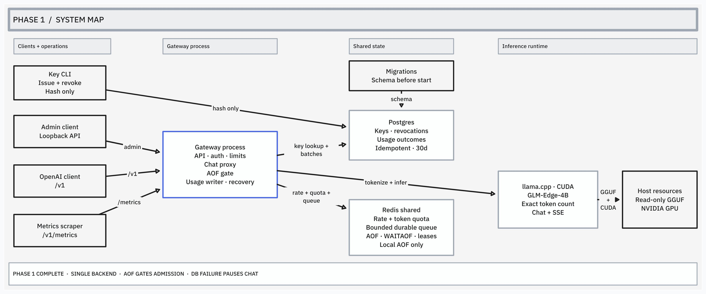

# llmgate

`llmgate` is an OpenAI-compatible LLM gateway written in Go. It sits in front of
an inference server such as llama.cpp and handles API-key authentication,
request-rate limits, daily token quotas, validation, streaming, cancellation,
and deadlines. The inference server loads the model and generates tokens.

Phase 1 is complete for one backend. Model listing, JSON and streaming chat,
health checks, request logs, durable Redis accounting with batched Postgres
delivery, initial Prometheus metrics, and optional operator-local key management
are implemented and verified.
Crash recovery, quota-settlement replay, storage guards, and retention complete
the accounting path. The [final baseline and fault checks](docs/benchmarks.md)
record the evidence. Compose defines the gateway, pinned CUDA backend, Postgres, Redis, and startup migrations.

> **Not production-ready.** This is a project under active development.
> Do not use it in production.

## Quick start

Follow the [Compose setup](docs/manual-testing.md#compose-deployment) for the
model, NVIDIA runtime, local credentials, and API-key creation. After preparing
`deploy/.env`, start the stack:

```sh
docker compose --env-file deploy/.env -f deploy/docker-compose.yml up --build -d --wait
```

In a client terminal with `API_KEY` set, stream a response from the documented
backend's `glm-edge-4b-chat` model:

```sh
curl -N http://127.0.0.1:8080/v1/chat/completions \
  -H "Authorization: Bearer $API_KEY" \
  -H 'Content-Type: application/json' \
  -d '{"model":"glm-edge-4b-chat","messages":[{"role":"user","content":"Hello"}],"stream":true}'
```

## Architecture



Models and chat require an API key. Health and readiness are public. The optional
admin listener binds to loopback and requires a separate operator token.

## Documentation

- [Setup, configuration, and testing](docs/manual-testing.md)
- [Architecture, package responsibilities, and code reading order](docs/architecture.md)
- [Design decisions](docs/decisions.md)
- [Benchmarks](docs/benchmarks.md)
- [Project scope and planned work](docs/PROJECT_INTENT.md)
