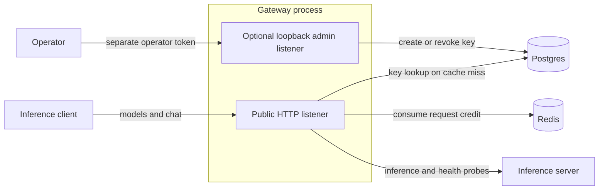

# llmgate

`llmgate` is an OpenAI-compatible LLM gateway written in Go. It sits in front of
an inference server such as llama.cpp and handles API-key authentication,
request-rate limits, validation, streaming, cancellation, and deadlines. The
inference server loads the model and generates tokens.

Phase 1 is in progress with one backend. Model listing, JSON and streaming chat,
health checks, request logs, and optional operator-local key management work
today.

> **Not production-ready.** This is a project under active development.
> Do not use it in production.

## Quick start

Use Go 1.27 or later. Follow the [setup guide](docs/manual-testing.md) to start
llama.cpp, Postgres, and Redis, apply migrations, and create an API key. The
gateway and inference backend currently run on the host; development Compose
runs Postgres and Redis.

With `GATEWAY_DATABASE_URL` and `PGPASSWORD` set as described in the guide:

```sh
GATEWAY_ADDR=127.0.0.1:8080 \
GATEWAY_UPSTREAM_URL=http://127.0.0.1:8081 \
go run ./cmd/gateway
```

In a client terminal with `API_KEY` set, stream a response from the documented
backend's `glm-edge-4b-chat` model:

```sh
curl -N http://127.0.0.1:8080/v1/chat/completions \
  -H "Authorization: Bearer $API_KEY" \
  -H 'Content-Type: application/json' \
  -d '{"model":"glm-edge-4b-chat","messages":[{"role":"user","content":"Hello"}],"stream":true}'
```

## Architecture



Models and chat require an API key. Health and readiness are public. The optional
admin listener binds to loopback and requires a separate operator token.

## Documentation

- [Setup, configuration, and testing](docs/manual-testing.md)
- [Architecture, package responsibilities, and code reading order](docs/architecture.md)
- [Design decisions](docs/decisions.md)
- [Benchmarks](docs/benchmarks.md)
- [Project scope and planned work](docs/PROJECT_INTENT.md)
