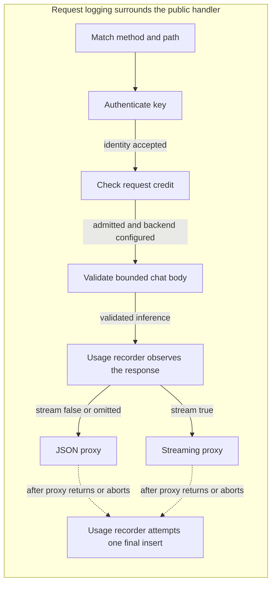

# Architecture

This page explains the implemented, single-backend gateway in Phase 1. Start
with the [system map](../README.md#architecture), then use this page to
trace a request and find the package responsible for each step. The
[project intent](PROJECT_INTENT.md) describes planned work. Queues, multi-backend
routing, daily token quotas, and Prometheus metrics are not
implemented yet.

## One chat request

What happens to `POST /v1/chat/completions`? The arrows below show handler
order, including deferred finalization. External services appear in the README
system map, not this handler diagram. The logging wrapper assigns a
request ID before routing and logs completion when the inner handlers return.

Authentication requires one Bearer credential. A successful lookup registers
the request for local revocation and adds the key identity and limits to its
context. Invalid credentials return `401`; database lookup failures return `503`
on a cache miss. The lookup deadline ends before forwarding starts.

Request admission consumes one credit from the key's Redis token bucket.
Exhaustion returns `429` with `Retry-After`; Redis failures return `503`.
These rejections stop before validation or inference. Admission has its own
deadline, which does not limit the subsequent inference request. Once admitted,
a request keeps its charge even if validation, forwarding, or delivery fails.

Chat validation bounds the body, checks the JSON object and response mode, and
validates or supplies `max_tokens`. It preserves backend-specific fields. The
backend checks the model, messages, and generation options. Validation buffers
the body, so the handler clones the request and supplies a new body reader to
the chosen proxy while preserving its context.

The proxy removes the gateway Authorization header, sets the upstream target
and request ID, and forwards the request. The backend generates the response;
the proxy copies its status, headers, and body to the client. Responses travel
back through the same HTTP handler call, not through a second admission check.

Validated chat enters a usage recorder before the selected proxy. It observes
only bytes accepted by the client-facing writer and preserves flushes and proxy
abort panics. One bounded final insert runs after proxy copying finishes, even
on disconnect or abort. It records the request ID, key, backend, requested model,
HTTP status, outcome, timings, and observed backend token counts. The row contains
no prompt or response text. Models and pre-inference rejections do not create rows.

Other routes take shorter paths. Models authenticate and consume a credit but
skip chat validation. Liveness checks only the process. Readiness makes a fresh
backend health probe, bypassing authentication and Redis; it neither reserves
capacity nor gates chat traffic. If no backend is configured, models and chat
return `503` after authentication and admission, before chat validation.

## Package responsibilities

Each package link opens a starting point. The [code reading order](#read-the-code)
below connects the handlers for one streaming request.

| Package | Owns | Boundary |
| --- | --- | --- |
| [`cmd/gateway`](../cmd/gateway/run.go) | Configuration, component assembly, shared resources, listeners, shutdown, and local key-creation command. | Connects packages into a running service; handlers own request behavior. |
| [`internal/gateway`](../internal/gateway/handler.go) | Public routes, handler order, chat validation, and response-mode selection. | Backend validates generation-specific fields. |
| [`internal/auth`](../internal/auth/handler.go) | Caller identity, bounded identity cache, active-request tracking, and revocation coordination. | `store` persists keys; cancellation tracking belongs to this process. |
| [`internal/ratelimit`](../internal/ratelimit/handler.go) | Redis-backed atomic request admission and its deadline. | Request credits count HTTP requests, not generated tokens. |
| [`internal/proxy`](../internal/proxy/forward.go) | Upstream HTTP forwarding, credential removal, JSON deadlines, and streaming flushes and idle cancellation. | `gateway` selects response mode; backend generates tokens. |
| [`internal/backend`](../internal/backend/readiness.go) | On-demand backend readiness probes. | No periodic health registry or backend selection yet. |
| [`internal/usage`](../internal/usage/recorder.go) | Bounded JSON/SSE observation and one final usage-write attempt. | Counts describe observed backend usage; recording does not enforce daily quotas. |
| [`internal/store`](../internal/store/usage.go) | Postgres pool setup, key lifecycle, and usage insertion. | Callers own pool lifetime and operation deadlines. |
| [`internal/admin`](../internal/admin/handler.go) | Operator-token authentication and private key-management routes. | Creation calls `store`; revocation calls the shared authenticator. |
| [`internal/requestlog`](../internal/requestlog/handler.go) | Request IDs and start/finish logs around handlers. | Normal handler return does not establish successful inference or delivery. |
| [`internal/api`](../internal/api/error.go) | Shared JSON error envelope and writing it to HTTP responses. | Callers choose the status and error details. |

## Read the code

For `POST /v1/chat/completions` with `stream: true`, follow these entry points:

1. [`run`](../cmd/gateway/run.go) constructs dependencies and assembles handlers.
2. [`requestlog.NewHandler`](../internal/requestlog/handler.go) surrounds
   [`gateway.NewHandler`](../internal/gateway/handler.go), which matches the route.
3. [`auth.handler.ServeHTTP`](../internal/auth/handler.go) authenticates and
   registers the request through [`lookupAndRegister`](../internal/auth/active.go).
4. [`ratelimit.handler.ServeHTTP`](../internal/ratelimit/handler.go) checks admission
   through [`RedisStore.Take`](../internal/ratelimit/store.go) and
   [`bucket.lua`](../internal/ratelimit/bucket.lua).
5. [`chatHandler.ServeHTTP`](../internal/gateway/chat.go) validates the body and
   selects the response mode, then calls [`Recorder.Record`](../internal/usage/recorder.go).
6. [`streamHandler.ServeHTTP`](../internal/proxy/stream.go) adds idle cancellation;
   [`newForwarder`](../internal/proxy/forward.go) rewrites the upstream request.
   Go's reverse proxy copies the response through the
   [observer](../internal/usage/observe.go). JSON delivery instead uses
   [`NewNonStreamingHandler`](../internal/proxy/nonstream.go) and a total deadline.
7. On normal return or panic unwinding, the recorder classifies the outcome and
   calls [`UsageStore.RecordUsage`](../internal/store/usage.go). The original panic
   continues after the write attempt.

Use the ownership sections below for revocation and shutdown. Setup and test
commands live in the [manual testing guide](manual-testing.md).

## Where state lives

- **Postgres** stores key hashes, identities, configured limits, and revocation
  timestamps, plus final usage records. Raw keys are returned once on creation.
  `tokens_per_day` is stored but not enforced yet.
- **Redis** stores request credits per key. Models and chat share the same bucket.
  Gateways serving the same key database must share the Redis database for a
  shared limit. Credits are admission state, not a durable billing ledger.
- **Process memory** holds the bounded identity cache and active-request registry
  in one shared authenticator. Cache hits do not renew expiry. During a database
  outage, unexpired cached identities can authenticate; misses and expired entries
  fail closed. Redis must still admit those requests. Cache expiry affects new
  authentication, not streams already admitted.
- **Each request context** carries logging metadata, authenticated identity, and
  cancellation through the handler chain. Authentication and admission use
  shorter-lived child contexts for their own deadlines. Their expiry does not
  become the stream's total deadline.

Admin revocation first updates Postgres, then invalidates local cached identities
and signals active requests for that key. The cache and registry share a mutex;
coordination with in-flight lookups prevents an overlapping lookup from restoring
a revoked identity. Other gateway processes receive no cancellation signal.
Direct SQL revocation also sends no local signal; cached identities can remain
usable until expiry. A successful admin response acknowledges the update and
local signals, not that backend decoding has already stopped. See the
[revocation decision](decisions.md#revocation-and-active-requests) for coordination details.

## Response lifetime and cleanup

JSON forwarding has a total upstream deadline, including response-body reads.
Streaming has connection, response-header, and idle-body-read limits, with no
total stream deadline. An idle limit bounds each wait for backend bytes, not
time between model tokens. The reverse proxy flushes copied bytes immediately;
the usage observer parses complete SSE data events while forwarding continues.
Its line/event and JSON buffers have explicit bounds. Oversized payloads continue
to the client; unavailable metadata stays unknown rather than failing inference.

Before response headers are sent, upstream timeouts return `504` and connection
failures return `502`. Backend HTTP error responses pass through. After the
response starts, a copy failure ends an incomplete response. The gateway cannot
replace its status or append a guaranteed structured error. It has no application
retry or backend failover policy today.

Client disconnects cancel upstream HTTP work through the inherited request
context. An idle-body timeout cancels that stream's child context; local
revocation cancels the authenticated request context. These are signals to stop
HTTP work, not proof that a particular model server stopped decoding. The
[manual cancellation check](manual-testing.md#6-test-client-disconnect-cancellation)
covers real-backend verification.

As handlers exit, the stream wrapper stops or joins its read timer, deferred
cancellation releases child contexts, and authentication removes the request
from its registry. The outer logger records elapsed time and whether its inner
handler returned normally. An HTTP error can still have `completed: true`;
an aborted proxy response can have `completed: false`.

## Usage records and missing information

`total_ms` measures gateway arrival through proxy completion or abort, excluding
the final database write. Streaming `ttft_ms` measures arrival through the first
complete, nonterminal SSE data event accepted by the response writer. This can
be a role-only event; it is not a backend GPU timestamp or proof of client
receipt. Comments and `[DONE]` do not count. JSON requests have no observed TTFT.
The separate request-finish log also includes time spent finalizing usage.

`observed_sse_chunks` counts complete data events other than `[DONE]`, including
role-only, error, and usage-only events. It is not a model-token count. Token
counts come only from a valid backend `usage` object with both nonnegative
counts. Missing, partial, malformed, or oversized metadata leaves both counts
NULL. The recorder does not request extra usage events or rewrite the stream.
The requested model is NULL when absent or unsuitable for bounded text storage.

A normally returned 2xx JSON response or a 2xx SSE response ending in `[DONE]`
is `completed`. HTTP failures and observed SSE error payloads are `failed`.
Client or local-revocation cancellation is `canceled`. An abort, writer failure,
or SSE EOF without `[DONE]` is `interrupted`. HTTP status remains separate, so
an interrupted stream can have HTTP 200. These states describe observation at
the gateway, not a durable billing or delivery guarantee.

The final write uses `context.WithoutCancel` to retain logging metadata while
detaching client/revocation cancellation, then adds its own timeout. It is
synchronous and may delay handler or response completion up to that bound.
No connection is held for the duration of inference; the insert acquires one
from the existing pool. Failure logs a fixed error and does not rewrite the
response. There is no retry, background queue, or crash-recovery ledger. Process
exit or forced shutdown can lose a final write. The
[decision](decisions.md#inference-usage-recording) records this availability tradeoff.

## Startup and shutdown ownership

[`run`](../cmd/gateway/run.go) opens and checks Postgres and Redis before binding
HTTP listeners, constructs one authenticator shared by public and admin handlers,
and owns the shared upstream transport. Both enabled listeners bind before
either serves. A partial bind failure closes listeners already opened. The
one-off key-creation command uses Postgres without starting either HTTP server.

On a termination signal, or an unexpected server exit,
[`runServers`](../cmd/gateway/server.go) stops both enabled listeners and drains
them concurrently under one deadline. Active requests can finish during that
window. Deadline expiry force-closes remaining connections, which cancels their
HTTP request contexts. Shutdown joins serving and shutdown goroutines before
returning to `run`, which closes idle upstream connections and releases Redis
and Postgres. The process signal starts draining; it does not immediately
cancel every active stream.
