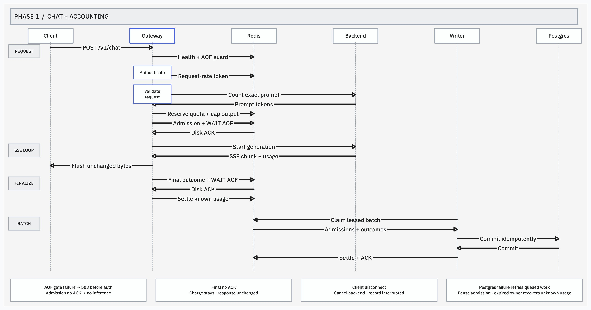
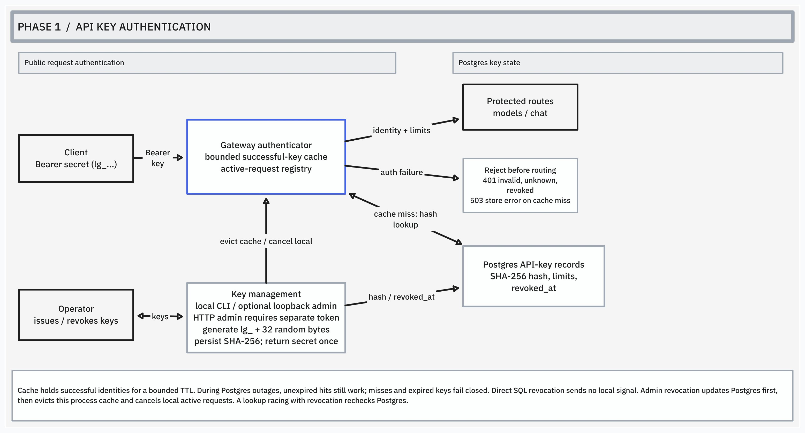

# Architecture

This page explains the implemented gateway, including Phase 2 health monitoring,
least-loaded routing, and bounded inference admission. Start
with the [system map](../README.md#architecture), then use this page to
trace a request and find the package responsible for each step. The
[project intent](PROJECT_INTENT.md) describes planned work. Circuit breakers remain planned work.

## One chat request

What happens to `POST /v1/chat/completions`? The Phase 1 sequence shows
generation, response streaming, and durable accounting. The local inference
queue now runs between validation and quota preparation, as described below. The logging wrapper
assigns a request ID before metrics and routing, then logs completion after the
inner handlers return.

A cached background storage check runs before routing. Unsafe accounting
storage rejects models and chat before authentication or rate-limit writes;
probes and metrics still reach their handlers.

### Authentication lifecycle

Authentication requires one Bearer credential. A successful lookup registers
the request for local revocation and adds the key identity and limits to its
context. Invalid credentials return `401`; database lookup failures return `503`
on a cache miss. The lookup deadline ends before forwarding starts.

Request admission consumes one credit from the key's Redis token bucket.
Exhaustion returns `429` with `Retry-After`; Redis failures return `503`.
These rejections stop before validation or inference. Admission has its own
deadline, which does not limit the subsequent inference request. Once admitted,
a request keeps its charge even if validation, forwarding, or delivery fails.

Validated chat selects a healthy backend and acquires its local FIFO inference capacity
before quota preparation or durable accounting. Each backend slot bounds one
request across preparation and proxying, including prefill and either response
mode. When all healthy backends are full, routing returns `429` with `Retry-After: 1`; an expired wait
returns `503`. Cancellation removes the waiter. These requests consume their
request-rate credit but create no token reservation or durable inference record.

The queue mutex makes grants, cancellation, and slot transfers atomic. One timer
bounds each wait; the queue creates no worker goroutines and stores no bodies or
contexts. A grant racing cancellation or expiry returns its slot before rejecting.
Release transfers capacity to the oldest waiter and is idempotent, so deferred
cleanup can safely cover both early failures and proxy aborts. State is local to
one gateway process, independent of the durable Redis accounting queue. Multiple
gateway replicas do not share inference capacity.

Chat validation bounds the body, checks the JSON object and response mode, and
validates or supplies `max_tokens`. It preserves backend-specific fields. The
backend checks the model, messages, and generation options. Quota preparation
also checks text content, one-completion bounds, and generation-limit aliases. Validation buffers
the body, so the handler clones the request and supplies a new body reader to
the chosen proxy while preserving its context. Before that clone enters the
proxy, `quota` renders and tokenizes the text prompt, reserves its allowance in
Redis, and caps `max_tokens` to the output budget. It requests final usage for
streams. Counting and Redis have independent deadlines that do not bound generation.

The proxy removes the gateway Authorization header, sets the upstream target
and request ID, and forwards the request. The backend generates the response;
the proxy copies its status, headers, and body to the client. Responses travel
back through the same HTTP handler call, not through a second admission check.

Validated chat hands admission to the shared Redis queue before calling the
selected proxy. It records identity, backend/model metadata, and the Redis
reservation ID, original UTC day, and allowance. `usage.Recorder.Observe` uses a
client-cancelable deadline. Queue failure returns `503` and attempts to refund the
unused allowance. Successful disk acknowledgment prepares response observation.
Its writer observes only bytes accepted by the client-facing writer and preserves
flushes. The chat handler ends proxy metrics and releases its inference slot, then
classifies the outcome, durably hands off final usage, and settles quota. Failed final handoff retains the charge.
This cleanup also runs on disconnect or proxy abort. Interrupted SSE can end
with a bounded terminal error event; other aborts keep their panic.
There are no prompt/response bodies or credentials in accounting records.

Other routes take shorter paths. Models authenticate and consume a credit but
skip chat validation. Liveness checks only the process. Readiness reads the backend registry’s health snapshot, bypassing authentication
and Redis; it reserves no capacity. Models and chat use the same health source. If no backend is configured, they
return `503` after authentication and admission, before chat validation.

## Backend health ownership

Startup registers every configured backend. The legacy single URL becomes `primary`.
Each registered backend starts
unhealthy and has one worker that probes `/health` immediately, then periodically.
Only HTTP 200 is successful; redirects are not followed and response bodies are
closed without buffering. Consecutive successes restore health; consecutive
failures remove it. An opposite result resets the streak. State changes are logged
with the backend name, without upstream URLs or transport diagnostics.

The registry mutex protects health and streaks; callers receive independent
snapshots. Readiness returns 200 when any backend is healthy and 503 otherwise.
It performs no network work. This smooths transient failures at the cost of delayed
failure detection and recovery. New selections exclude unhealthy backends. Until
at least one passes its startup success threshold, models and validated chat
return `503` with `no_backend`. Existing assignments, including waiters, keep their
selected backend; health transitions do not cancel or migrate them.

Startup owns the monitor context separately from request contexts. Each probe
has its own deadline; stopping the monitor cancels in-flight probes and joins
all workers, then clears health. Monitoring survives HTTP drain and stops before
the shared transport closes its idle connections.

## Routing and assignment ownership

The router chooses the healthy backend with the fewest local assigned requests,
skipping backends whose active-plus-waiting limit is reached. Assignments cover
queue waiting, token counting, durable admission, and proxying. Equal-load choices
rotate through configuration order. Model listing selects a healthy backend
without reserving inference capacity and returns that server's model list.
Configured targets should serve the same model aliases; there is no model-based
routing or merged model catalog.

One router mutex protects selection and assignment increments together. Requests
waiting for a queue slot therefore count immediately, even before entering the
queue. The mutex is released before waiting, counting tokens, or doing network
work. Each queue separately protects its FIFO grants and cancellation. A failed
acquisition clears its assignment. A successful acquisition returns an idempotent
release function that clears both the queue slot and router assignment before
final accounting, including during proxy aborts. The router adds no goroutines.

The selected bundle owns that backend's prompt counter, JSON/SSE proxies, queue,
and usage recorder identity. Redis quota state and durable accounting storage
remain shared. A request never counts on one backend and generates on another.
No healthy target returns `503`; no room across healthy targets returns `429`.
Counting and admission failures do not trigger retries. Load is a request count,
not token cost or GPU utilization, and applies only to this gateway process.

### Retry attempts and response commitment

Chat allows at most two attempts, each on a different backend. The gateway first
captures transport failures and backend `502`, `503`, or `504` responses that
would otherwise commit an error response. It does not buffer successful JSON or
SSE responses. A final header, backend informational response, body write, or
flush blocks retry. The last attempt passes backend HTTP errors through normally.
Model listing, counting failures, quota errors, and durable-admission failures
are not retried.

Each attempt releases its inference assignment and saves final usage before the
next can start. Failed final handoff stops retry. Unknown consumption keeps its
quota charge. A retry recounts on its new backend, obtains a fresh reservation,
and records a separate durable admission; it may receive `429` if the first
attempt left insufficient budget. Client cancellation, revocation, or accounting
ownership cancellation stops retry. If no alternate can enter its bounded queue,
the client receives the original upstream failure rather than a new queue error.

The public request ID stays unchanged. The first durable row uses that ID; the
second appends `:attempt-2`. Reservations and cancellation callbacks belong to
each attempt separately. The first usage interval starts at client arrival; the
second starts before its own queue wait. Captured failures have HTTP status zero
in their usage row because no attempt response was delivered. The final public
HTTP status and full request duration still appear once in request metrics.
Attempts use independent upstream deadlines, so retries can extend total latency.

## Package responsibilities

Each package link opens a starting point. The [code reading order](#read-the-code)
below connects the handlers for one streaming request.

| Package | Owns | Boundary |
| --- | --- | --- |
| [`cmd/gateway`](../cmd/gateway/run.go) | Configuration, component assembly, shared resources, listeners, shutdown, and local key-creation command. | Connects packages into a running service; handlers own request behavior. |
| [`internal/gateway`](../internal/gateway/handler.go) | Public routes, validation, chat attempts, response commitment, and finalization. | Backend validates generation-specific fields. |
| [`internal/auth`](../internal/auth/handler.go) | Caller identity, bounded identity cache, active-request tracking, and revocation coordination. | `store` persists keys; cancellation tracking belongs to this process. |
| [`internal/ratelimit`](../internal/ratelimit/handler.go) | Redis-backed atomic request admission and its deadline. | Request credits count HTTP requests, not generated tokens. |
| [`internal/quota`](../internal/quota/limiter.go) | Exact backend prompt counting, atomic daily reservations, output caps, and settlement. | Backend enforces generation limits; Redis owns shared budget state. |
| [`internal/proxy`](../internal/proxy/forward.go) | Upstream HTTP forwarding, credential removal, JSON deadlines, and streaming flushes and idle cancellation. | `gateway` selects response mode; backend generates tokens. |
| [`internal/router`](../internal/router/router.go) | Healthy least-loaded selection and local assignment lifetimes. | Does not retry or own health probes; caller releases inference assignments. |
| [`internal/queue`](../internal/queue/queue.go) | Local FIFO inference capacity and bounded waiting. | Chat owns slot release; no quota or durable accounting state. |
| [`internal/backend`](../internal/backend/registry.go) | Periodic health monitoring and snapshot-based readiness. | Publishes snapshots shared by readiness and routing. |
| [`internal/usage`](../internal/usage/recorder.go) | Bounded JSON/SSE observation and durable admission/final handoffs. | Returns the observed outcome and writes usage when called; `gateway` owns metrics and quota finalization. |
| [`internal/accounting`](../internal/accounting/queue.go) | Shared durable Redis slots, owner fencing, recovery, settlement replay, and retention. | Postgres and quota settlement finish before Redis acknowledgment; no inference body is retained. |
| [`internal/store`](../internal/store/usage.go) | Postgres pool setup, key lifecycle, and atomic accounting batches. | Callers own pool lifetime and operation deadlines. |
| [`internal/admin`](../internal/admin/handler.go) | Operator-token authentication and private key-management routes. | Creation calls `store`; revocation calls the shared authenticator. |
| [`internal/metrics`](../internal/metrics/metrics.go) | Private Prometheus registry, bounded key labels, request observations, TTFT, active streams, and scraping. | Authentication tags identity; the usage observer supplies streaming events. Scraping reads no external dependencies. |
| [`internal/requestlog`](../internal/requestlog/handler.go) | Request IDs and start/finish logs around handlers. | Normal handler return does not establish successful inference or delivery. |
| [`internal/api`](../internal/api/error.go) | Shared JSON error envelope and writing it to HTTP responses. | Callers choose the status and error details. |

## Read the code

For `POST /v1/chat/completions` with `stream: true`, follow these entry points:

1. [`run`](../cmd/gateway/run.go) constructs dependencies and assembles handlers.
2. [`requestlog.NewHandler`](../internal/requestlog/handler.go) surrounds
   [`metrics.Metrics.Observe`](../internal/metrics/metrics.go) and
   [`accounting.Queue.Protect`](../internal/accounting/storage.go), then
   [`gateway.NewHandler`](../internal/gateway/handler.go), which matches the route.
3. [`auth.handler.ServeHTTP`](../internal/auth/handler.go) authenticates and
   registers the request through [`lookupAndRegister`](../internal/auth/active.go).
4. [`ratelimit.handler.ServeHTTP`](../internal/ratelimit/handler.go) checks admission
   through [`RedisStore.Take`](../internal/ratelimit/store.go) and
   [`bucket.lua`](../internal/ratelimit/bucket.lua).
5. [`chatHandler.ServeHTTP`](../internal/gateway/chat.go) validates the body.
   [`forward` and `attempt`](../internal/gateway/attempt.go) own the retry loop and
   call [`Router.Acquire`](../internal/router/router.go) to select a healthy backend
   and wait through [`Queue.Acquire`](../internal/queue/queue.go), then select its
   response mode. [`Limiter.Admit`](../internal/quota/limiter.go) counts
   input and reserves output. [`Recorder.Observe`](../internal/usage/recorder.go)
   hands admission to [`accounting.Queue`](../internal/accounting/queue.go)
   before preparing the response observer. The handler supplies the first-data
   notification for metrics, and starts proxy metrics.
6. [`streamHandler.ServeHTTP`](../internal/proxy/stream.go) adds idle cancellation;
   [`newForwarder`](../internal/proxy/forward.go) rewrites the upstream request.
   Go's reverse proxy copies the response through the
   [observer](../internal/usage/observe.go). JSON delivery instead uses
   [`NewNonStreamingHandler`](../internal/proxy/nonstream.go) and a total deadline.
7. On normal return or panic unwinding, the chat handler releases the active-stream
   gauge and inference slot, then gets the outcome from [`Observation.Finish`](../internal/usage/recorder.go).
   It calls [`Recorder.Write`](../internal/usage/recorder.go) for the bounded
   durable final handoff, then settles the permit through
   [`Permit.Finish`](../internal/quota/limiter.go) only when handoff succeeds.
   JSON and undeliverable SSE aborts continue after cleanup; a delivered terminal
   SSE error lets the response finish.

Use the ownership sections below for revocation and shutdown. Setup and test
commands live in the [manual testing guide](manual-testing.md).

## Where state lives

- **Postgres** stores key hashes, identities, configured limits, and revocation
  timestamps and delivered inference admissions/final usage records. Raw keys are returned once on creation.
  `tokens_per_day` supplies the normal daily token budget.
- **Redis** stores request credits per key, plus daily spent and reserved tokens
  in `llmgate:tokens:v1:<key_id>`. Models and chat share the request bucket;
  only validated chat reserves token budget. It also holds durable accounting
  slots, a ready index, writer and request-owner leases, ownership mappings,
  and an expiring Postgres-health marker.
  Gateways serving the same key database must share the Redis database for a
  shared limit. Credits are admission state, not a durable billing ledger.
- **Process memory** holds the bounded identity cache and active-request registry
  in one shared authenticator. Cache hits do not renew expiry. During a database
  outage, unexpired cached identities can authenticate; misses and expired entries
  fail closed. Cached models can still pass Redis admission, but chat also needs
  a durable Redis admission. A detected Postgres delivery failure pauses chat. Cache expiry affects new
  authentication, not streams already admitted.
- **Each request context** carries logging metadata, authenticated identity, and
  cancellation through the handler chain. Authentication and admission use
  shorter-lived child contexts for their own deadlines. Their expiry does not
  become the stream's total deadline.

Admin revocation first updates Postgres, then invalidates local cached identities
and signals active requests for that key. The cache and registry share a mutex;
coordination with in-flight lookups prevents an overlapping lookup from restoring
a revoked identity. Other gateway processes receive no cancellation signal.
Direct SQL revocation also sends no local signal; cached identities can remain
usable until expiry. A successful admin response acknowledges the update and
local signals, not that backend decoding has already stopped. See the
[revocation decision](decisions.md#revocation-and-active-requests) for coordination details.

## Response lifetime and cleanup

JSON forwarding has a total upstream deadline, including response-body reads.
Streaming has connection, response-header, and idle-body-read limits, with no
total stream deadline. An idle limit bounds each wait for backend bytes, not
time between model tokens. The reverse proxy flushes copied bytes immediately;
the usage observer parses complete SSE data events while forwarding continues.
Its line/event and JSON buffers have explicit bounds. Oversized payloads continue
to the client; unavailable metadata stays unknown rather than failing inference.

Before response commitment, a transport timeout can retry; its final gateway
error is `504`. Other transport failures return `502` when failover cannot help.
The [retry boundary](#retry-attempts-and-response-commitment) defines eligible
HTTP errors. Other backend responses pass through. A committed JSON copy failure
aborts the response. An SSE copy failure or EOF without a terminal marker appends
one `event: error` when the attempt context remains live and bounded delivery works.
It does not append `[DONE]` or restart generation. A backend's existing terminal
error event is preserved. Terminal error delivery uses the configured stream-idle
budget as a write deadline, then clears it before accounting. If a deadline cannot
be installed or delivery fails, the original abort behavior closes the response.

Client disconnects cancel upstream HTTP work through the inherited request
context. An idle-body timeout cancels that stream's child context; local
revocation cancels the authenticated request context. These are signals to stop
HTTP work, not proof that a particular model server stopped decoding. The
[manual cancellation check](manual-testing.md#6-test-client-disconnect-cancellation)
covers real-backend verification.

As handlers exit, the stream wrapper stops or joins its read timer, deferred
cancellation releases child contexts, and authentication removes the request
from its registry. The outer logger records elapsed time and whether its inner
handler returned normally. An HTTP error can still have `completed: true`;
an aborted proxy response can have `completed: false`.

## Token allowance ownership

`quota.Limiter` owns immutable dependencies. Each admitted chat gets one
`Permit` containing its Redis reservation, with no retained body or context.
The chat handler finishes that permit during normal return or panic unwinding.
Before generation starts, a failed durable admission releases the unused allowance
with a zero charge. A failed release logs the failure and retains the charge.
A completed response with matching usage refunds unused output. Uncertain
outcomes retain the full allowance while releasing the pending marker. A failed
final handoff leaves the marker pending as well.

Redis serializes reservations and settlement with Lua. Pending allowances count
against admission, and duplicate settlements cannot refund twice. The Redis day
and expiry belong to admission, so a stream ending tomorrow cannot change
tomorrow's budget. Dependency failures stop new inference before forwarding.
Settlement failures retain the charge and preserve the response. A crashed
request's marker expires with its daily counter. See the
[quota decision](decisions.md#daily-input-and-output-quotas) for grace, supported
inputs, and durability limits.

## Usage records and missing information

`total_ms` measures an attempt through proxy completion or abort, excluding
its token settlement and final write. The initial attempt includes arrival-time
work; a retry starts at its own queue selection. Streaming `ttft_ms` measures
that attempt interval through the first
complete, nonterminal SSE data event accepted by the response writer. This can
be a role-only event; it is not a backend GPU timestamp or proof of client
receipt. Comments and `[DONE]` do not count. JSON requests have no observed TTFT.
The separate request-finish log also includes time spent finalizing usage.

`observed_sse_chunks` counts complete data events other than `[DONE]`, including
role-only, error, and usage-only events. It is not a model-token count. Token
counts come only from a valid backend `usage` object with both nonnegative
counts. Missing, partial, malformed, or oversized metadata leaves both counts
NULL. Quota preparation requests final SSE usage; the recorder observes those
events without treating chunks as token counts. Gateway-generated terminal errors
bypass the backend observer, so they do not invent backend events or TTFT.
The requested model is NULL when absent or unsuitable for bounded text storage.

A normally returned 2xx JSON response or a 2xx SSE response ending in `[DONE]`
is `completed`. HTTP failures and observed SSE error payloads are `failed`.
Client or local-revocation cancellation is `canceled`. An abort, writer failure,
or SSE EOF without `[DONE]` is `interrupted`. HTTP status remains separate, so
an interrupted stream can have HTTP 200. These states describe observation at
the gateway, not a durable billing or delivery guarantee.

Final handoff uses `context.WithoutCancel` to retain logging metadata while
removing client/revocation cancellation, then adds its own timeout. It can delay
handler or response completion, but its timeout does not bound generation.

`accounting.Queue` uses fixed 8 KiB admission and outcome values in
`llmgate:accounting:v1:records`, with a ready sorted set. Admission allocates both
values atomically and checks shared capacity and writer health. Outcome writes
replace an existing reserved value; Lua allows these bounded replacements under
memory pressure. `WAITAOF` on the same Redis connection confirms local AOF sync
before either handoff succeeds. All replicas must share this namespace and use
consistent capacity settings. Redis Cluster is not configured by this deployment.

The leased writer polls at the flush interval, pipelines Redis reads, and sends
at most one configured batch to `store.RecordBatch`. Admissions and known final
usage commit in one synchronous transaction. An admission-only acknowledgment
retains its outcome slot. A final acknowledgment frees both slots, but only if
neither value changed during the database write. Multiple gateway replicas may
run workers; a lease prevents normal concurrent batch ownership. Lease expiry
can cause duplicate delivery, which immutable Postgres conflict checks make safe.
Full batches drain without waiting for another timer tick, up to eight batches
per turn so cancellation and other work remain responsive.

When no records or expired owners need attention, fresh shared health skips
redundant writer leases and Postgres probes. Once half the health lifetime has
elapsed, an empty batch probes Postgres. A failed delivery clears shared
admission health;
a stalled/dead writer loses health after `2 * write timeout + 2 * flush interval`.
New chat then returns `503`; existing streams retain final-write capacity. There
is no per-request Postgres availability check. A lost queue acknowledgment leaves
records for replay after restart. Never trim pending records to free space.

Each gateway owns a random, expiring accounting identity. Its heartbeat renews
every third of the lease lifetime; renewal cannot revive an expired identity.
Admission registers its cancellation callback only while the same identity is
still current. Losing ownership cancels those requests, and Redis fences late
final writes. The next successful heartbeat can establish a fresh identity.

The writer uses Redis time to find expired owners and reconstructs their
unfinished requests in bounded batches. Recovery produces `interrupted` usage
with unknown token counts, HTTP status zero, and `recovered = true`. Its duration
is the interval from admission to recovery, not an observed inference duration.
Saved final outcomes take precedence. A crash before final handoff can lose exact
backend usage, but leaves a durable admission from which this outcome is recovered.

After Postgres commit, the writer retries quota settlement against the admission's
original UTC day before acknowledging the queue record. Settlement is
idempotent with the request's normal cleanup path. Unknown consumption retains
the reservation; replay never refunds twice or changes the next day's allowance.

A storage guard runs before protected routes can write rate-limit state. Bounded
background checks reject models and chat with `503` when AOF writes fail or the
configured AOF admission threshold is reached. They cancel active generation
while preserving ownership so reserved final slots can still be filled. The
threshold leaves rewrite and final-result headroom; it is not a filesystem quota.

`Queue.Run` owns and joins its heartbeat and retention goroutines. Retention
deletes old finalized accounting pairs in bounded Postgres transactions, keeping
unfinished admissions and API keys. Its cutoff uses an indexed request-start
time and request ID. Startup keeps these workers alive through HTTP drain, then
stops and joins them before
closing storage pools. Redis local AOF does not protect against disk loss or
stale-replica failover.
The [decision](decisions.md#durable-accounting-admission-policy) owns the tradeoffs.

## Prometheus measurement boundaries

Each gateway process owns a private registry for request and admission metrics. Public
request counters and duration histograms finish after the handler returns or
unwinds, including quota settlement and usage writing. They include probes,
validation/authentication failures, models, and chat. Scrapes and the separate
admin listener are excluded. Status is the observed HTTP status, or `none` when
cancellation or a panic ends the request before headers. A 200 status does not
establish successful stream completion.

Authentication records the verified key ID on the request's shared observation
state. Model proxying and admitted chat mark their configured backend name;
requests without a successful selection, including queue rejections, use `none`. Unknown paths, request IDs, model names, raw
keys, and payloads never become labels. The registry admits a bounded number of
key-ID labels for its lifetime and groups further identities under `other`.
The default capacity is zero, so all authenticated keys share `other`; per-key
labels require an explicit positive capacity.
Metrics reset when the process restarts. See the
[metrics decision](decisions.md#initial-prometheus-metrics) for the label policy.

The queue-depth gauge reads the local queue's mutex-protected snapshot at scrape
time and counts only waiting requests. It starts at zero and is omitted when no
queue is supplied to metrics. The gauge callback adds no worker or upstream call.
The chat handler records one queue-wait histogram sample when a selected
backend's capacity acquisition returns, before quota preparation. This includes
immediate grants, queue timeouts, cancellations, and unavailable admission for
that target. Routing rejections without a selected backend add no wait sample.
Pending waiters have no sample until they leave acquisition. Queue-full,
queue-timeout, and no-healthy-backend results increment `gateway_rejected_total`;
cancellation is not an overload rejection. Metrics cover JSON and SSE chat with
fixed, configured backend labels. Rate-limit rejection reasons remain planned work.

Streaming inference increments its gauge before proxying, including prefill,
and decrements before accounting begins, even on cancellation or abort. The
existing SSE observer supplies one TTFT observation at its first complete data
event. Its framing matches usage TTFT above, but metric timing always starts
at client arrival, including failed attempts and their cleanup. Retry usage
TTFT starts at that attempt instead. No event
means no TTFT sample, and JSON responses produce none. The metrics writer
preserves flushes and response control through `Unwrap`; its status is atomic
because reverse-proxy flushing may use another goroutine.

`GET /v1/metrics` and its HEAD form bypass authentication, Redis, quota checks,
and the backend. Scraping has a concurrency cap and a deadline. It exposes only
these application collectors, with no default process or Go-runtime collectors.

## Startup and shutdown ownership

Startup loads [typed subsystem settings](../cmd/gateway/config.go) once. Each
loader owns its defaults and validation; checks involving both server and admin
settings run after assembly. Runtime components receive explicit settings from
this validated config.

[`run`](../cmd/gateway/run.go) opens and checks Postgres and Redis before binding
HTTP listeners, constructs one authenticator shared by public and admin handlers,
and owns the shared upstream transport. It validates Redis persistence and starts
one accounting loop with owned heartbeat and retention workers before binding
listeners. Their independent context keeps them alive through HTTP draining. Both enabled listeners bind before
either serves. A partial bind failure closes listeners already opened. The
one-off key-creation command uses Postgres without starting either HTTP server.

On a termination signal, or an unexpected server exit,
[`runServers`](../cmd/gateway/server.go) closes request admission and drains both
listeners concurrently under one deadline. A shared lifecycle tracker surrounds
each complete handler, including logging and deferred accounting. Its mutex
coordinates admission with shutdown; late requests receive the shared `503`
error instead of entering application handlers.

Already queued requests participate in HTTP draining. They may acquire a slot
within their queue deadline while the gateway rejects new handlers. Forced
connection closure cancels queued request contexts, removes waiters, and cancels
active proxying. Preparation failures and proxy cleanup release occupied slots.
The queue has no separate worker to stop or join.

Deadline expiry force-closes connections and cancels their HTTP request contexts.
A separate cleanup deadline then bounds waiting for registered handlers to finish
quota settlement and usage writes. This wait uses a completion channel, with no
extra goroutine per request or abandoned wait goroutine on timeout. Both listeners
share the window. A cleanup timeout reports the remaining handler count.

Only after serving workers, shutdown workers, and bounded request cleanup does
`run` cancel and join its accounting worker, then release Redis and Postgres.
Already acknowledged records can remain queued for a replacement worker. Postgres
pool teardown can separately wait for the pinned driver's failed-connection
cleanup deadline; the container stop grace includes that allowance. The process
signal starts draining; it does not immediately cancel every active stream.
A crash before final handoff or unavailable recording storage can still leave
only an admission. Local disk acknowledgment does not reconstruct missing usage.

## Container boundaries

Compose starts Postgres and Redis with named volumes, runs migrations to
completion, and waits for the pinned CUDA backend before starting the gateway.
The model is a read-only host file. The gateway runs as a non-root user with a
read-only root filesystem. Its executable is also used for local key creation.
Only the gateway, Postgres, and Redis publish host ports, all on loopback.
The inference backend is reachable through the container network and has no
published port. Admin HTTP stays on gateway-container loopback and is disabled
by default. Docker's gateway stop grace exceeds the application's default
shutdown deadline and bounded accounting tail. Health checks report status;
they do not replace request-time dependency checks or trigger container restarts
by themselves. Setup and verification limits live in the
[Compose guide](manual-testing.md#compose-deployment).
